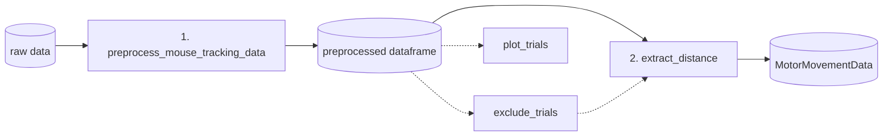

# Mouse-tracking toolbox

Preprocess mouse-tracking trial data and turn it into time-resolved distance
arrays, with plotting and exclusion tools. It works for any task where a
participant clicks a start button, sees a stimulus, and moves to one of *n*
response buttons (2, 4, 8, ...), whatever the stimuli and button layout.

See the [workflow](workflow.md) for the input, output and steps of each module.

| Page | Content |
|---|---|
| [Workflow](workflow.md) | The two main modules, with their inputs, outputs and steps |
| [Quickstart](quickstart.md) | Install and run the whole pipeline on demo data |
| [Input data](input-data.md) | Columns your raw data needs and the standard output columns |
| [Preprocessing and exclusions](preprocessing.md) | Standardising trajectories and excluding trials |
| [Distances](distances.md) | `extract_distance`: metrics, ordering, interpolation, time axis |
| [Data object](data-object.md) | `MotorMovementData`: dimensions, averaging, saving |
| [Plotting](plotting.md) | `plot_trials` and `plot_binary_trials` |
| [Demos](demos.md) | Two runnable scripts: preprocessing stages, distance metrics |
