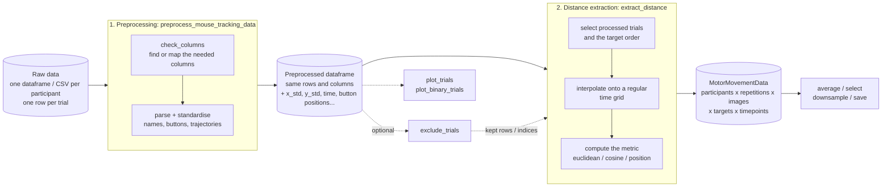

# Workflow

The toolbox has two main modules. **Preprocessing** turns raw trial rows into
standardised trajectories; **distance extraction** turns those trajectories into
one time-resolved array. Quality control and plotting work on the output of the
first module.

## Module 1: preprocessing

**Input.** A dataframe (or a list, one per participant) with one row per trial
and the columns described in [Input data](input-data.md). Extra rows (surveys,
instructions) and extra columns are fine.

**What happens.**

1. **Column check.** `check_columns` looks for the needed columns under their
   usual names, or uses your `column_map`. A copy is added under the standard
   name (`response`, `accuracy`, `stimulus`...); your own columns are untouched.
2. **Row selection.** Only rows that can be processed are filled in: they have
   mouse samples, a stimulus, button names and a screen size (and pass your
   optional `row_mask`). The others are kept with empty new columns.
3. **Parsing.** Button names, button rectangles and the start button are parsed;
   the image ID is extracted from the stimulus; the mouse samples become `time`,
   `x` and `y` arrays.
4. **Standardising.** Pixels become standardised units: origin at the screen
   centre, one unit = half the shorter screen side (`scaling="min_side"`, which
   keeps the aspect ratio), y pointing up. Button and start positions are
   converted the same way.
5. **Bookkeeping.** `ppt_number` and `repetition` (how often a participant saw an
   image) are added if absent.

**Output.** The same dataframe plus `x_std`, `y_std`, `time`,
`response_button_positions_std`, `starting_button_position_std`, `std_scale`,
`repetition`, `ppt_number` and the standard-named copies. `processed_trial_mask(df)`
tells which rows hold a trajectory.

**Optional: exclusions.** `exclude_trials` flags trials by endpoint and travelled
distance and can return the excluded indices.

## Module 2: distance extraction

**Input.** The preprocessed dataframe (optionally after exclusions).

**What happens.**

1. **Trial selection.** Rows with a trajectory are used. Participants,
   repetitions and images define the array's first three dimensions.
2. **Target order.** For euclidean and cosine, the response buttons become the
   `targets` dimension, in the order you give with `target_names` (default: the
   order found in the data).
3. **Interpolation.** Mouse samples are irregular. Each trial's x and y are
   linearly interpolated onto a regular grid (`sampling_interval`, up to
   `duration`). Before the first sample the array is NaN, unless
   `fill_start=True` places the cursor at the start button; after the last
   sample it is NaN.
4. **Metric.** `euclidean`: distance to each button. `cosine`: cosine distance
   between the movement direction (from the start button) and each button's
   direction. `position`: x and y (or one of them) over time.

**Output.** A [`MotorMovementData`](data-object.md) with named dimensions
(`participants`, `repetitions`, `images`, `targets` or `coordinates`,
`timepoints`), labels and metadata (metric, image IDs, button positions, start
positions). From there: `average`, `select`, `downsample`, `save`.
